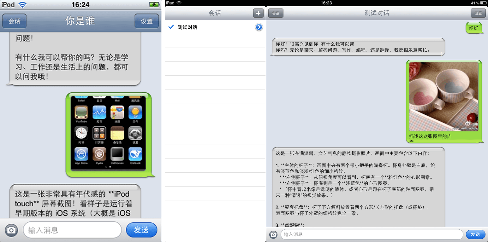

#
<p align="center">

<h1 align="center">BiliDown</h1>
<h3 align="center">最低可以运行在 iOS 3.1.3 系统上的原生 DeepSeek 客户端<br>
</p>

## 预览



## 功能

- 使用内置 mbedTLS 直连 `api.deepseek.com`（TLS 1.2），无需中转服务器或转发后端。
- 流式回复，iOS 3 Messages 风格气泡和会话列表。
- iPad 原生分栏：左侧会话、右侧聊天；设置、会话重命名和相册选择使用 popover。
- 支持文字和图片消息（DeepSeek 视觉能力）
- 多会话：新建、重命名、删除和本地持久化。
- 简体中文和英文界面。

> 需要越狱：应用以系统应用形式安装到 `/Applications`

## 安装

- 下载 [Release](https://github.com/lihaoyun6/OldSeek/releases/latest) 中的 `.ipa` 或 `.deb` 安装包并在越狱设备上安装。

## 手动编译

依赖：macOS、Xcode 命令行工具、iPhoneOS 3.1.3 SDK 和 `ldid`。

```bash
export SDK=/path/to/iPhoneOS3.1.3.sdk
./build.sh            # 同时编译两个架构
./build.sh armv6      # iPod -> build/
./build.sh armv7      # iPad -> build-armv7/
```

脚本默认在 `$TMPDIR/sdk/iPhoneOS3.1.3.sdk` 查找 SDK，可用 `SDK=` 覆盖；`JOBS=N` 控制并行编译数，`./build.sh clean` 删除构建目录。  
编译后可以把签名后的 app 拷到越狱设备并重启 SpringBoard：

```bash
scp -r build/OldSeek.app root@<设备地址>:/Applications/
ssh root@<设备地址> 'killall -9 SpringBoard'
```

## 第三方

- [mbedTLS](https://github.com/Mbed-TLS/mbedtls) — Apache-2.0
- [cJSON](https://github.com/DaveGamble/cJSON) — MIT

> OldSeek 与 DeepSeek 官方没有关系，是业余开发的第三方客户端。
